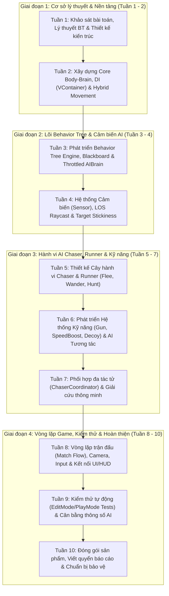

# KẾ HOẠCH VÀ BÁO CÁO TIẾN ĐỘ ĐỒ ÁN TỐT NGHIỆP

**Đề tài:** Nghiên cứu và phát triển hệ thống AI NPC dựa trên Behavior Tree cho game đuổi bắt  
**Thời lượng thực hiện:** 10 tuần  
**Dự án thực nghiệm:** ChaseGame (Unity 3D - URP)

---

## PHẦN I: KẾ HOẠCH TỔNG THỂ 10 TUẦN



| Tuần | Chủ đề trọng tâm | Các đầu việc chính (Tasks) | Sản phẩm bàn giao (Deliverables) |
| :--- | :--- | :--- | :--- |
| **Tuần 1** | Nghiên cứu cơ sở lý thuyết & Thiết kế kiến trúc hệ thống | - Nghiên cứu lý thuyết Behavior Tree, Blackboard, NavMesh; so sánh BT với FSM.<br>- Đặc tả bài toán game đuổi bắt 2 phe (`Chaser` vs `Runner`).<br>- Thiết kế kiến trúc tách biệt **Brain – Body** và Dependency Injection (`VContainer`).<br>- Khởi tạo project Unity, cấu hình `.asmdef`, dựng map 3D và Bake NavMesh. | - Bản nháp Chương 1 & Chương 2.<br>- Sơ đồ kiến trúc Brain–Body, Class Diagram.<br>- Map 3D đã Bake `Game_Map_NavMesh.asset`. |
| **Tuần 2** | Xây dựng nền tảng Nhân vật (`Body`) & Cơ chế Hybrid Movement | - Cài đặt `Team`, `CaptureState`, `CharacterStats`, `Character` (Command Gating khi bị bắt).<br>- Phát triển `CharacterMovement` kết hợp `CharacterController` và `NavMeshAgent`.<br>- Cài đặt `PlayerBrain` và `CharacterAnimationController`.<br>- Viết Unit Test kiểm thử toán học di chuyển và khóa lệnh. | - Module `ChaseGame.Characters` & `ChaseGame.Brains`.<br>- Pass 17/17 Unit Tests (`CharacterMovementMathTests`, `CharacterCommandGatingTests`). |
| **Tuần 3** | Phát triển Core Behavior Tree Engine, Blackboard & Khung `AIBrain` | - Xây dựng `Node`, `NodeStatus`, `Selector`, `Sequence`, `ConditionNode`, `ActionNode`.<br>- Thiết kế `Blackboard` và `AIConfig` ScriptableObject.<br>- Xây dựng `AIBrain` (Throttled Tick 8 Hz, lệch pha ngẫu nhiên) và hành vi `Wander`. | - Package `ChaseGame.AI.BehaviourTree`.<br>- Pass 15/15 Unit Tests (`SelectorTests`, `SequenceTests`, `BehaviourTreeLeafTests`, `BehaviourTreeIntegrationTests`). |
| **Tuần 4** | Hệ thống Nhận thức & Cảm biến AI (`Sensor`, LOS Raycast & Stickiness) | - Xây dựng `ITeamRoster`, `TeamRoster` quản lý danh sách 2 đội.<br>- Phát triển `Sensor`: lọc ứng viên theo phe, kiểm tra khuất tường bằng `Physics.Raycast` (`HasLineOfSight`).<br>- Cài đặt thuật toán chọn mục tiêu `NearestVisible` có độ bám dính (Target Stickiness & Hysteresis). | - Module `Sensor` và `TeamRoster`.<br>- Pass 12/12 Unit Tests (`SensorSelectionTests`, `TeamRosterTests`). |
| **Tuần 5** | Thiết kế & Cài đặt Cây hành vi cho NPC Chaser và NPC Runner | - Thiết kế `ChaserAIBrain` (Hunt, lưu vị trí thấy cuối cùng khi mất dấu, Wander).<br>- Thiết kế `RunnerAIBrain` (`ThreatNear` có hysteresis `1.35x`, thuật toán `PickBestFleePoint` quét 7 góc chạy trốn trên NavMesh). | - Hoàn thiện `ChaserAIBrain` & `RunnerAIBrain`.<br>- Pass bộ Unit Test `ChaserAIBrainTests`, `RunnerAIBrainTests`. |
| **Tuần 6** | Phát triển Hệ thống Kỹ năng (`Abilities`) & Tương tác AI với Kỹ năng | - Xây dựng `IAbility`, `CooldownTimer`, `CharacterAbilities`.<br>- Cài đặt `SpeedBoost`, `Gun` + `EggProjectile`, và `Decoy` + `DecoyLure`.<br>- Tích hợp dùng kỹ năng vào BT và huấn luyện AI phân thân (`ConfigureAsClone`) đánh lạc hướng Chaser. | - Module `ChaseGame.Abilities`.<br>- Pass bộ Unit Test `CooldownTimerTests`, `SpeedMultiplierTests`, `GunTargetingTests`. |
| **Tuần 7** | Phối hợp Đa tác tử (`ChaserCoordinator`) & Hành vi Giải cứu | - Xây dựng `ICaptureService`, `CaptureServiceStub`, `CageStub`.<br>- Phát triển `ChaserCoordinator` phân công AI Chaser canh lồng giam (`GuardPost`).<br>- Cài đặt nhánh `GoRescue` và kiểm tra an toàn `FindSafeRescueTarget` cho `RunnerAIBrain`. | - Module `ChaserCoordinator` & `CaptureServiceStub`.<br>- Pass `ChaserCoordinatorTests`, `CaptureServiceStubTests`. |
| **Tuần 8** | Vòng lặp Trận đấu (`Match Flow`), Hệ thống Spawn, Camera & UI/HUD | - Xây dựng `CharacterFactory`, `SpawnManager`, `SpawnSettings`.<br>- Tích hợp `InputSystemService`, `UltimateJoystickInput`, `CameraLookTouchPad`, `SimpleFollowCamera`.<br>- Phát triển `MatchController`, `MatchEvaluator`, `MatchHudView`, `AbilityButtonView` (kèm Chaser Aim Assist), `MatchEndView`. | - Hoàn thiện vòng lặp trận đấu từ `Loading` -> `Game` -> `EndView`.<br>- Pass `SpawnManagerTests`, `MatchControllerTests`, `MatchEvaluatorTests`. |
| **Tuần 9** | Kiểm thử Tích hợp (`PlayMode Tests`), Đánh giá Hiệu năng & Tinh chỉnh AI | - Viết 4 bộ PlayMode Tests (`HybridMovementPlayTests`, `ChaserAIPlayTests`, `ChaserCapturePlayTests`, `RunnerFleePlayTests`).<br>- Đo đạc hiệu năng CPU của Throttled BT (8 Hz) và cân bằng thông số `AIConfig`, `CharacterStats`. | - Toàn bộ 22 file EditMode Tests & 4 file PlayMode Tests đạt Pass.<br>- Chương Thực nghiệm & Đánh giá kết quả. |
| **Tuần 10** | Hoàn thiện Quyển Báo cáo Đồ án, Đóng gói Build & Chuẩn bị Bảo vệ | - Tổng hợp, rà soát và định dạng toàn bộ quyển báo cáo Đồ án tốt nghiệp.<br>- Đóng gói bản Build thực thi, quay video demo các kịch bản AI.<br>- Thiết kế slide thuyết trình và chuẩn bị bảo vệ trước hội đồng. | - Quyển Báo cáo Đồ án hoàn chỉnh.<br>- Source code, Bản Build Game, Video Demo, Slide bảo vệ. |

---

## PHẦN II: NỘI DUNG CHI TIẾT BÁO CÁO TIẾN ĐỘ 4 TUẦN ĐẦU TIÊN

---

### BÁO CÁO TIẾN ĐỘ TUẦN 1
**Chủ đề tuần 1:** *Nghiên cứu cơ sở lý thuyết Behavior Tree, Đặc tả bài toán Game Đuổi Bắt và Thiết kế kiến trúc tổng thể*

#### 1. Mục tiêu trong tuần
* Nghiên cứu tổng quan về các kiến trúc điều khiển AI trong trò chơi điện tử, trọng tâm là **Behavior Tree (Cây hành vi)** và **Blackboard**.
* Phân tích yêu cầu chức năng, phi chức năng và luật chơi của bài toán game đuổi bắt bất đối xứng (Asymmetric Chase Game).
* Thiết kế kiến trúc phần mềm tách biệt **Brain – Body** kết hợp **Dependency Injection (VContainer)** và khởi tạo môi trường dự án Unity.

#### 2. Nội dung công việc đã thực hiện
1. **Nghiên cứu lý thuyết AI cho NPC:**
   * Phân tích hạn chế của Máy trạng thái hữu hạn (*Finite State Machine - FSM*): Khi số lượng trạng thái $N$ tăng lên (Tuần tra, Đuổi bắt, Bắn, Canh lồng, Chạy trốn, Giải cứu, Phân thân...), số lượng chuyển tiếp trạng thái tăng theo bậc $O(N^2)$, gây khó khăn khi bảo trì và mở rộng.
   * Nghiên cứu cấu trúc **Behavior Tree (BT)**: Tổ chức quyết định theo cấu trúc cây phân cấp định hướng độ ưu tiên từ trái sang phải, bao gồm:
     * *Composite Nodes*: `Selector` (hoạt động như cổng OR, chọn nhánh con đầu tiên thành công) và `Sequence` (hoạt động như cổng AND, thực thi tuần tự các nhánh con).
     * *Leaf Nodes*: `ConditionNode` (kiểm tra điều kiện môi trường) và `ActionNode` (thực thi hành động).
     * *Trạng thái trả về*: `Success`, `Failure`, `Running`.
   * Nghiên cứu kiến trúc bộ nhớ chia sẻ **Blackboard** giúp tách biệt dữ liệu nhận thức (Perception Data) khỏi logic duyệt cây.
2. **Đặc tả bài toán Game Đuổi Bắt (`ChaseGame`):**
   * Xác định 2 phe đối kháng bất đối xứng:
     * **Phe Đi Săn (`Team.Chaser`)**: Tốc độ cơ bản chậm hơn (`5 m/s`), sở hữu kỹ năng tấn công tầm xa (`Gun` bắn trứng) và `SpeedBoost`, nhiệm vụ bắt giam toàn bộ Runner trong thời gian quy định.
     * **Phe Chạy Trốn (`Team.Runner`)**: Tốc độ cơ bản cao hơn (`6 m/s`), sở hữu kỹ năng thoát thân (`SpeedBoost`, `Decoy` tạo phân thân), nhiệm vụ sinh tồn đến hết giờ (90 giây) và giải cứu đồng đội bị nhốt.
3. **Thiết kế kiến trúc phần mềm & Khởi tạo dự án:**
   * Thiết kế mô hình **Brain – Body Separation**:
     * **Body (`Character`)**: Đóng vai trò là thực thể vật lý trong không gian 3D, cung cấp giao diện nhận lệnh (`Move`, `MoveTo`, `Stop`, `UseAbility`).
     * **Brain (`CharacterBrain`)**: Đóng vai trò bộ não ra quyết định. Nhờ thiết kế này, một Prefab nhân vật duy nhất có thể gắn `PlayerBrain` (người chơi điều khiển) hoặc `AIBrain` (NPC tự động) lúc runtime.
   * Cấu hình dự án Unity (URP), phân tách Assembly Definition (`ChaseGame.asmdef`, `ChaseGame.Tests.EditMode.asmdef`, `ChaseGame.Tests.PlayMode.asmdef`) để phục vụ kiểm thử tự động.
   * Xây dựng bản đồ 3D có chướng ngại vật và thực hiện Bake dữ liệu tìm đường NavMesh (`Assets/NavMeshData/Game_Map_NavMesh.asset`).

#### 3. Kết quả đạt được & Minh chứng
* Hoàn thành đề cương chi tiết và bản nháp Chương 1 (Tổng quan đề tài & Cơ sở lý thuyết), Chương 2 (Phân tích và thiết kế hệ thống).
* Sơ đồ kiến trúc tổng thể hệ thống và Class Diagram mối quan hệ giữa `Character` (Body) – `CharacterBrain` (Brain).
* Dự án Unity đã tích hợp `VContainer`, `Unity Input System`, `DOTween` và bản đồ 3D đã Bake `NavMesh`.

#### 4. Khó khăn gặp phải & Giải pháp
* **Vấn đề:** Một số plugin bên thứ ba (như `UltimateJoystick` phục vụ điều khiển di động) không có file `.asmdef`, dẫn đến việc code trong assembly `ChaseGame` không thể tham chiếu trực tiếp mà không phá vỡ cấu trúc module.
* **Giải pháp:** Áp dụng mẫu thiết kế **Dependency Inversion & Adapter Pattern**: Định nghĩa giao diện `IJoystickInput` bên trong `ChaseGame` (`Assets/Scripts/Input/IJoystickInput.cs`), và đặt lớp chuyển đổi `UltimateJoystickInput` (`Assets/GameScripts/Input/UltimateJoystickInput.cs`) ở `Assembly-CSharp` rồi tiêm (inject) qua `VContainer`.

#### 5. Kế hoạch tuần 2
* Xây dựng các lớp thực thể nhân vật (`Character`, `CharacterStats`, `Team`, `CaptureState`).
* Nghiên cứu và cài đặt cơ chế di chuyển lai (**Hybrid Movement**) kết hợp `CharacterController` và `NavMeshAgent`.
* Xây dựng `PlayerBrain`, `CharacterAnimationController` và viết bộ Unit Test kiểm thử toán học di chuyển.

---

### BÁO CÁO TIẾN ĐỘ TUẦN 2
**Chủ đề tuần 2:** *Xây dựng nền tảng Nhân vật (Body), Điều khiển cơ bản và Cơ chế Di chuyển lai (Hybrid Movement)*

#### 1. Mục tiêu trong tuần
* Hiện thực hóa lớp `Character` (Body) và cơ chế khóa hành động khi nhân vật rơi vào trạng thái bị bắt (`CaptureState.Jailed`).
* Giải quyết bài toán đồng bộ vật lý giữa nhân vật do người chơi điều khiển (dùng vector hướng) và NPC AI (dùng tìm đường NavMesh) trên cùng một thành phần di chuyển.
* Viết Unit Test kiểm chứng toàn bộ hàm toán học di chuyển và cơ chế khóa lệnh (Command Gating).

#### 2. Nội dung công việc đã thực hiện
1. **Cài đặt thực thể `Character` (`Assets/Scripts/Characters/Character.cs`) và Dữ liệu cấu hình:**
   * Xây dựng enum `Team` (`Chaser`, `Runner`) và `CaptureState` (`Free`, `Jailed`).
   * Xây dựng `ScriptableObject` `CharacterStats` và khởi tạo 2 file cấu hình: `ChaserStats.asset` (`moveSpeed = 5`) và `RunnerStats.asset` (`moveSpeed = 6`).
   * Thiết lập cơ chế **Command Gating** trong `Character`: Khi `CaptureState` chuyển sang `Jailed`, setter tự động gọi `movement.Stop()` để triệt tiêu quán tính trượt, đồng thời chặn toàn bộ lệnh `Move()`, `MoveTo()`, `UseAbility()`.
2. **Phát triển cơ chế Hybrid Movement (`Assets/Scripts/Characters/CharacterMovement.cs`):**
   * Thay vì để `NavMeshAgent` trực tiếp dịch chuyển `Transform` của NPC (gây xung đột va chạm với `CharacterController`), hệ thống tắt quyền cập nhật vị trí/góc xoay tự động của Agent:
     ```csharp
     agent.updatePosition = false;
     agent.updateRotation = false;
     ```
   * Thiết kế 2 chế độ hoạt động (`Mode.Direction` cho Player và `Mode.Agent` cho NPC AI):
     * Ở chế độ `Mode.Agent`, `NavMeshAgent` chỉ tính toán đường đi và vận tốc mong muốn (`agent.desiredVelocity`).
     * Vector hướng được làm mượt bằng nội suy cầu (`Vector3.Slerp`) trong hàm `SmoothDirection` với hệ số `steeringSmoothRate = 16f` nhằm loại bỏ hiện tượng giật cục do thuật toán tránh vật cản cục bộ (RVO) của NavMesh.
     * Góc xoay nhân vật được cập nhật mượt trên mặt phẳng ngang $XZ$ qua hàm `ComputeNextRotation` (`turnSpeed = 540°/s`).
     * Cuối mỗi frame, `CharacterController.Move()` thực thi di chuyển kèm trọng lực `Physics.gravity`, sau đó đồng bộ ngược vị trí thực tế về lại cho Agent: `agent.nextPosition = transform.position`.
   * Tối ưu hiệu năng tìm đường trong `MoveTo(Vector3 destination)`: Chỉ gọi `agent.SetDestination` khi khoảng cách bình phương giữa đích mới và đích cũ vượt ngưỡng `0.0225f` ($0.15\text{m}$), tránh việc tính lại đường đi không cần thiết.
3. **Cài đặt `PlayerBrain` và `CharacterAnimationController`:**
   * Chuyển đổi trục điều khiển 2D sang vector di chuyển 3D tương đối theo hướng nhìn của Camera (`ToCameraRelativeMove`).
   * Kết nối vận tốc phẳng của `CharacterController` vào tham số `Speed` của `Animator` với damping `0.1s`.

#### 3. Kết quả đạt được & Minh chứng
* Hoàn thành module `ChaseGame.Characters` và `ChaseGame.Brains`.
* Kiểm thử thành công tìm đường NavMesh bằng công cụ `NavMeshMoveProbe`.
* **17/17 kịch bản Unit Test (EditMode) đạt Pass 100%**:
  * `CharacterMovementMathTests.cs` (10 tests): Kiểm thử vận tốc, chuẩn hóa vector chéo, điều kiện dừng tại đích (`ShouldStopAtDestination`), tốc độ xoay góc và làm mượt hướng đi.
  * `CharacterCommandGatingTests.cs` (7 tests): Sử dụng `SpyCharacterMovement` kiểm chứng nhân vật dừng ngay khi vào tù (`EnteringJail_StopsMovementOnce`) và từ chối mọi lệnh di chuyển khi đang ở trạng thái `Jailed`.

#### 4. Khó khăn gặp phải & Giải pháp
* **Vấn đề:** Khi NPC tiến gần đến điểm đích, do vận tốc nhân vật luôn chạy ở tốc độ tối đa (`BaseSpeed * speedMultiplier`) nên nhân vật bị bước lố qua điểm đích (overshoot) và quay đầu dao động liên tục quanh điểm đích.
* **Giải pháp:** Xây dựng hàm kiểm tra `ShouldStopAtDestination(bool pathPending, float remainingDistance, float stoppingDistance)`. Khi đường đi đã tính xong (`!pathPending`) và khoảng cách còn lại $\le$ `stoppingDistance` (`0.3m`), vector hướng được gán về `Vector3.zero` ngay lập tức, giúp NPC dừng lại dứt khoát.

#### 5. Kế hoạch tuần 3
* Thiết kế và cài đặt lõi **Behavior Tree Engine** (`Node`, `NodeStatus`, `Selector`, `Sequence`, `ConditionNode`, `ActionNode`).
* Xây dựng cấu trúc dữ liệu `Blackboard`, `AIConfig` và lớp cơ sở `AIBrain` có cơ chế nhịp suy nghĩ định kỳ (`TickRateHz`) cùng hành vi đi tuần (`Wander`).

---

### BÁO CÁO TIẾN ĐỘ TUẦN 3
**Chủ đề tuần 3:** *Phát triển Core Behavior Tree Engine, Bộ nhớ Blackboard và Khung điều khiển AIBrain*

#### 1. Mục tiêu trong tuần
* Xây dựng bộ thư viện **Behavior Tree** thuần C# (không phụ thuộc vào `MonoBehaviour`), hỗ trợ khai báo cây hành vi trực quan bằng cú pháp hàm (Functional/Delegate-based).
* Thiết kế `Blackboard` và `AIConfig` để quản lý dữ liệu nhận thức và tham số điều chỉnh AI.
* Xây dựng lớp cơ sở `AIBrain` điều tiết tần suất ra quyết định (Throttled Tick) và cài đặt thuật toán đi tuần tự nhiên (`Wander`) trên NavMesh.

#### 2. Nội dung công việc đã thực hiện
1. **Xây dựng Core Behavior Tree Engine (`Assets/Scripts/AI/BehaviourTree/`):**
   * Định nghĩa enum `NodeStatus` (`Success`, `Failure`, `Running`) và lớp trừu tượng `Node` với phương thức `NodeStatus Tick(Blackboard bb)`.
   * **Composite Node – `Selector`**: Duyệt tuần tự danh sách các node con; nếu một node con trả về `Success` hoặc `Running`, lập tức ngắt mạch (short-circuit) và trả về trạng thái đó. Chỉ trả về `Failure` khi tất cả các con đều thất bại.
   * **Composite Node – `Sequence`**: Duyệt tuần tự các node con; nếu một node con trả về `Failure` hoặc `Running`, lập tức ngắt mạch và trả về trạng thái đó. Chỉ trả về `Success` khi toàn bộ chuỗi con đều thành công.
   * **Leaf Nodes – `ConditionNode` & `ActionNode`**: Nhận vào delegate `Func<Blackboard, bool>` và `Func<Blackboard, NodeStatus>`, giúp định nghĩa cây hành vi ngắn gọn mà không cần tạo hàng chục class con rời rạc.
2. **Thiết kế `Blackboard` (`Assets/Scripts/AI/BehaviourTree/Blackboard.cs`) và `AIConfig` (`Assets/Scripts/AI/AIConfig.cs`):**
   * `Blackboard` đóng vai trò túi dữ liệu trung tâm của mỗi NPC: chứa tham chiếu `Self`, `Roster`, `Config`, mục tiêu săn đuổi `CurrentTarget`, mối đe dọa `NearestThreat`, tọa độ đích tạm thời `Destination`, vị trí canh gác `GuardPost`, và cờ `IsFleeing`.
   * Tạo `ScriptableObject` `AIConfig.asset` với các thông số chuẩn: `visionRadius = 12m`, `shootRange = 8m`, `threatRadius = 6m`, `rescueThreatRadius = 5m`, `wanderRadius = 6m`, `tickRateHz = 8 Hz`.
3. **Phát triển lớp cơ sở `AIBrain` (`Assets/Scripts/AI/AIBrain.cs`) và Thuật toán `Wander`:**
   * **Cơ chế Throttled Decision Tick & Desynchronization**:
     * Thay vì chạy cảm biến và duyệt cây ở mỗi khung hình (60–120 lần/giây), `AIBrain` chỉ thực thi mỗi $\Delta t = \frac{1}{\text{TickRateHz}} = 0.125\text{s}$ (8 lần/giây).
     * Khởi tạo bộ đếm thời gian ban đầu bằng giá trị ngẫu nhiên `accum = Random.Range(0f, tickInterval)` để phân tán thời điểm suy nghĩ của các NPC sang các frame khác nhau, tránh hiện tượng tụt FPS đột ngột (CPU spike).
   * **Thuật toán đi tuần có định hướng (`Wander` & `TryRandomPoint`)**:
     * Khi NPC chưa có `Destination` hoặc đã đến gần đích ($\le 1.5\text{m}$), thuật toán tìm một điểm ngẫu nhiên mới trên NavMesh trong bán kính $[0.45R, R]$.
     * Trong 5 lần thử đầu tiên (trên tổng 8 lần lấy mẫu), góc lấy mẫu được giới hạn trong hình quạt phía trước mặt nhân vật $[-95^\circ, +95^\circ]$. Nếu bị kẹt sát tường mới mở rộng lấy mẫu $360^\circ$. Cách làm này giúp NPC đi dạo có quán tính tự nhiên, không bị quay ngoắt $180^\circ$ liên tục.

#### 3. Kết quả đạt được & Minh chứng
* Hoàn thiện toàn bộ gói `ChaseGame.AI.BehaviourTree` và lớp khung `AIBrain`.
* **15/15 kịch bản Unit Test (EditMode) cho Behavior Tree đạt Pass 100%**:
  * `SelectorTests.cs` (5 tests): Kiểm chứng cơ chế short-circuit khi gặp `Success`/`Running` và chuyển nhánh khi gặp `Failure`.
  * `SequenceTests.cs` (4 tests): Kiểm chứng cơ chế thực thi tuần tự và dừng ngay khi gặp `Failure`/`Running`.
  * `BehaviourTreeLeafTests.cs` (4 tests): Kiểm chứng `ConditionNode`, `ActionNode` và việc truyền tham chiếu `Blackboard`.
  * `BehaviourTreeIntegrationTests.cs` (2 tests): Kiểm thử tích hợp cây kết hợp `Selector` -> `Sequence` -> Fallback `Wander`.

#### 4. Khó khăn gặp phải & Giải pháp
* **Vấn đề:** Khi lấy mẫu ngẫu nhiên hoàn toàn $360^\circ$ bằng `Random.insideUnitCircle` trong hành vi `Wander`, NPC thường chọn điểm ngay sát chân mình hoặc quay ngược đầu liên tục, tạo cảm giác di chuyển thiếu tự nhiên.
* **Giải pháp:** Cải tiến hàm `TryRandomPoint` với ràng buộc khoảng cách tối thiểu `minDist = Mathf.Max(2.2f, radius * 0.45f)` và ưu tiên lấy mẫu theo hướng nhìn hiện tại (`forwardHint` $\pm 95^\circ$) trước khi fallback sang $360^\circ$ khi gặp góc tường.

#### 5. Kế hoạch tuần 4
* Xây dựng dịch vụ quản lý đội hình (`ITeamRoster`, `TeamRoster`).
* Phát triển hệ thống cảm biến thị giác `Sensor` với kiểm tra khuất tầm nhìn (`Physics.Raycast` Line-of-Sight) và thuật toán chống nhảy mục tiêu (**Target Stickiness & Hysteresis**).

---

### BÁO CÁO TIẾN ĐỘ TUẦN 4
**Chủ đề tuần 4:** *Phát triển Hệ thống Nhận thức & Cảm biến AI (Sensor, Line-of-Sight Raycast và Target Stickiness)*

#### 1. Mục tiêu trong tuần
* Xây dựng hệ thống quản lý danh sách nhân vật trong trận đấu (`TeamRoster`) để cung cấp dữ liệu đầu vào cho AI.
* Phát triển component cảm biến `Sensor` (`Assets/Scripts/AI/Sensor.cs`) giúp NPC nhận diện đối phương trong bán kính tầm nhìn và kiểm tra vật cản che khuất bằng Raycast.
* Giải quyết triệt để hiện tượng **Target Thrashing / Flickering** (AI đổi mục tiêu liên tục mỗi tick khi có 2 đối thủ đứng cách đều nhau).

#### 2. Nội dung công việc đã thực hiện
1. **Xây dựng hệ thống quản lý đội hình (`ITeamRoster`, `TeamRoster`):**
   * Lưu trữ danh sách `Chasers` và `Runners` đang có mặt trên bản đồ.
   * Cung cấp các phương thức truy vấn theo trạng thái thời gian thực: `GetFreeRunners()` (danh sách Runner đang tự do), `GetJailedRunners()` (danh sách Runner đang bị nhốt), và `AllRunnersJailed()`.
2. **Phát triển hệ thống cảm biến thị giác (`Assets/Scripts/AI/Sensor.cs`):**
   * **Trích xuất ứng viên (`CandidatesFor`)**:
     * Nếu bản thân là `Team.Chaser`: Chỉ lấy các Runner đang ở trạng thái `Free` (và các phân thân mồi nhử `DecoyLure` ở giai đoạn sau).
     * Nếu bản thân là `Team.Runner`: Lấy danh sách toàn bộ `Chasers` làm mối đe dọa.
   * **Kiểm tra đường nhìn thẳng (`HasLineOfSight`)**:
     * Nâng điểm gốc tia nhìn lên độ cao mắt nhân vật (`eyeHeight = 0.6m`) và dịch điểm xuất phát ra ngoài bán kính thân (`bodyClearance = 0.45m`).
     * Bắn `Physics.Raycast` từ mắt NPC tới mục tiêu. Nếu tia chạm phải `Collider` của một nhân vật khác, cảm biến coi như **không bị chắn** (đồng đội không làm mù tầm nhìn nhau); chỉ khi chạm vào địa hình/tường thực sự mới trả về `false`.
3. **Thuật toán khóa mục tiêu có độ bám dính (`NearestVisible` với Stickiness & Hysteresis):**
   * Khi có 2 mục tiêu $A$ (đang được chọn từ tick trước) và $B$ (mới xuất hiện) ở khoảng cách gần bằng nhau, nếu chỉ so sánh khoảng cách Euclid thuần túy, sai số nhỏ mỗi bước chân sẽ khiến Chaser quay đầu qua lại giữa $A$ và $B$.
   * **Công thức cải tiến trong `Sensor.NearestVisible`**:
     * **Nới rộng bán kính giữ dấu (*Retain Radius Hysteresis*)**: Mục tiêu mới phải nằm trong $R_{\text{base}} = 12\text{m}$, nhưng mục tiêu đang theo dõi được giữ dấu tới bán kính $R_{\text{retain}} = 1.15 \times R_{\text{base}} = 13.8\text{m}$.
     * **Trọng số ưu tiên mục tiêu hiện tại (*Stickiness Bias*)**: Điểm số khoảng cách bình phương của ứng viên $i$ được tính theo công thức:
       $$\text{Score}_i = \begin{cases} 0.64 \times \| \mathbf{p}_i - \mathbf{p}_{\text{self}} \|^2 & \text{nếu } i \text{ là mục tiêu hiện tại (isCurrent)} \\ \| \mathbf{p}_i - \mathbf{p}_{\text{self}} \|^2 & \text{nếu } i \text{ là mục tiêu mới} \end{cases}$$
       (Tương đương mục tiêu mới phải gần hơn ít nhất $20\%$ khoảng cách thực tế mới khiến Chaser từ bỏ mục tiêu đang đuổi).

#### 3. Kết quả đạt được & Minh chứng
* Hoàn thiện cơ chế kết nối `AIBrain` -> `Sensor.Sense(Blackboard)` -> Cập nhật `Blackboard.CurrentTarget` (cho Chaser) và `Blackboard.NearestThreat` (cho Runner).
* **12/12 kịch bản Unit Test (EditMode) đạt Pass 100%**:
  * `TeamRosterTests.cs` (4 tests): Kiểm chứng phân loại đội, lọc Runner tự do/bị bắt và điều kiện toàn bộ Runner bị bắt.
  * `SensorSelectionTests.cs` (8 tests): Kiểm chứng chọn mục tiêu gần nhất trong bán kính, loại bỏ mục tiêu ngoài tầm nhìn, bỏ qua mục tiêu gần nhưng bị tường chắn (`NearestVisible_SkipsBlockedAndTakesNextVisible`), và kiểm chứng độ bám dính mục tiêu (`NearestVisible_WithCurrentSelection_KeepsCurrentWhenOtherIsOnlySlightlyCloser`).

#### 4. Khó khăn gặp phải & Giải pháp
* **Vấn đề:** Khi thực hiện `Physics.Raycast` từ tâm nhân vật, tia Raycast đôi khi va chạm ngay vào chính `CharacterController` collider của bản thân NPC hoặc bị đồng đội đi trước mặt che mất tầm nhìn.
* **Giải pháp:** Dịch điểm đầu tia Raycast tiến về phía mục tiêu một khoảng `bodyClearance = 0.45m` (vượt qua bán kính `0.35m` của `CharacterController`) và kiểm tra `hit.collider.GetComponentInParent<Character>() != null` để bỏ qua va chạm với các nhân vật khác, đảm bảo chỉ có tường/chướng ngại vật bản đồ mới chặn tầm nhìn.

#### 5. Kế hoạch tuần 5
* Thiết kế và cài đặt cây hành vi chi tiết cho **NPC Đi săn (`ChaserAIBrain`)** và **NPC Chạy trốn (`RunnerAIBrain`)**.
* Xây dựng thuật toán chọn hướng chạy trốn đa góc (`PickBestFleePoint`) tránh bị dồn vào góc tường và cơ chế ghi nhớ vị trí thấy cuối cùng khi mất dấu mục tiêu.
