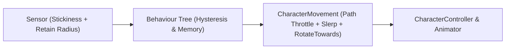
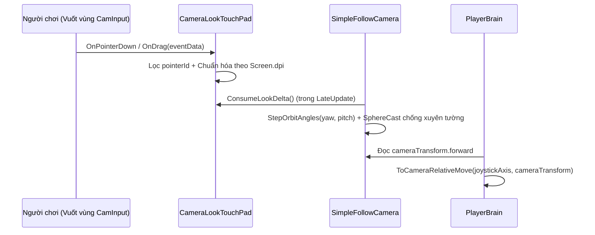
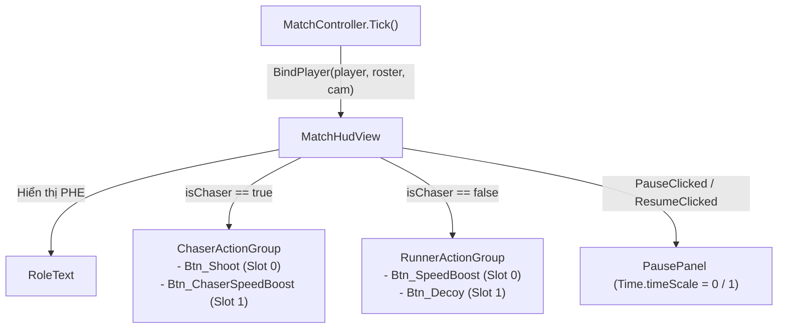
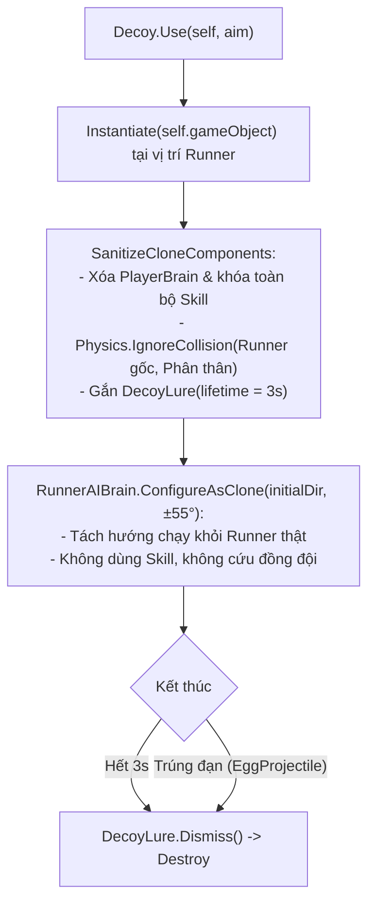
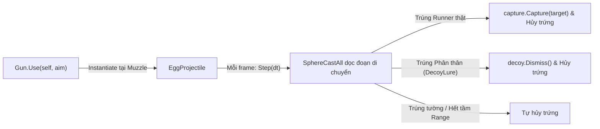
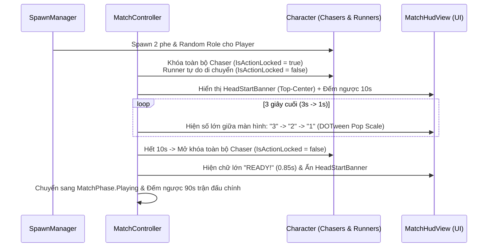

# Tài Liệu Thiết Kế & Triển Khai Các Tính Năng (Feature Design Document)

Tài liệu này tổng hợp toàn bộ **7 hạng mục tính năng và cải tiến** đã được phân tích, thiết kế, triển khai và kiểm thử tự động trong phiên làm việc.

---

## Mục Lục & Danh Sách Tính Năng Đã Triển Khai

| STT | Tên Tính Năng / Hạng Mục | Mã Commit | Trạng Thái Kiểm Thử |
| :-: | :--- | :---: | :---: |
| **1** | **Tối ưu hóa Chuyển động, Xoay hướng & Hành vi AI của NPC** | `5f5f1c6` | Pass (EditMode & PlayMode) |
| **2** | **Hệ thống Xoay Camera Orbit (TouchPad UI) & Di chuyển theo hướng Camera** | `17dfdbe` | Pass (EditMode) |
| **3** | **Hệ thống Giao diện HUD theo Vai trò, Vòng xoay Cooldown & Menu Tạm dừng** | `ddfcc1c` | Pass (EditMode) |
| **4** | **Kỹ năng Mồi nhử / Phân thân AI độc lập (`Decoy`) của Runner** | `58d3f94` | Pass (EditMode & PlayMode) |
| **5** | **Kỹ năng Bắn trứng (`EggProjectile`) của Chaser** | `fea98fc` | Pass (EditMode & PlayMode) |
| **6** | **Kỹ năng Tăng tốc chạy (`SpeedBoost`) cho Chaser (Prefab, AI & HUD)** | `75f5073` | Pass (EditMode) |
| **7** | **Hệ thống Lobby trong trận (Chạy trước 10s, Khóa Chaser & Đếm ngược `3 - 2 - 1 - READY!`)** | `HEAD` | Pass (EditMode 119/119) |

---

## Tính Năng 1: Tối Ưu Hóa Chuyển Động, Xoay Hướng & Hành Vi AI Của NPC (`5f5f1c6`)

### 1.1. Yêu cầu & Vấn đề thực tế
- **Hiện tượng ban đầu**: Các NPC (cả Chaser và Runner) di chuyển rất loạn, bị giật cục, xoay mặt liên tục hoặc đứng rung lắc tại chỗ, chuyển đổi trạng thái đuổi/chạy trốn/tuần tra liên tục ở ranh giới tầm nhìn và chạy thẳng vào tường khi bị dồn góc.
- **Mục tiêu**: Làm mượt toàn bộ chuyển động và góc xoay của NPC, loại bỏ hiện tượng dao động trạng thái (state thrashing) và giúp Runner tìm đường chạy thoát thông minh trên `NavMesh`.

### 1.2. Thiết kế & Giải pháp triển khai

1. **Làm mượt vận tốc, hướng lái và góc xoay cơ thể — [CharacterMovement.cs](file:///Users/m1/Documents/Manh/DoAnTotNghiep/Assets/Scripts/Characters/CharacterMovement.cs)**
   - **Nội suy hướng di chuyển ([`SmoothDirection`](file:///Users/m1/Documents/Manh/DoAnTotNghiep/Assets/Scripts/Characters/CharacterMovement.cs#L62-L76))**: Dùng `Vector3.Slerp` với `steeringSmoothRate = 16f` để lọc nhiễu cao tần từ thuật toán tránh vật cản RVO của `NavMeshAgent`.
   - **Xoay thân nhân vật ([`ComputeNextRotation`](file:///Users/m1/Documents/Manh/DoAnTotNghiep/Assets/Scripts/Characters/CharacterMovement.cs#L79-L93))**: Cập nhật `transform.rotation` mượt mà theo hướng di chuyển bằng `Quaternion.RotateTowards` (`turnSpeed = 540°/s`).
   - **Chống tính lại đường đi thừa ([`MoveTo`](file:///Users/m1/Documents/Manh/DoAnTotNghiep/Assets/Scripts/Characters/CharacterMovement.cs#L124-L144))**: Bỏ qua lệnh `agent.SetDestination` nếu đích đến mới lệch chưa tới `0.15m` (`0.0225f` sqrMagnitude) so với đích cũ.
2. **Chống giật trạng thái ở rìa tầm nhìn & tầm đe dọa — [Sensor.cs](file:///Users/m1/Documents/Manh/DoAnTotNghiep/Assets/Scripts/AI/Sensor.cs) & [RunnerAIBrain.cs](file:///Users/m1/Documents/Manh/DoAnTotNghiep/Assets/Scripts/AI/RunnerAIBrain.cs)**
   - **Target Stickiness ([`Sensor.NearestVisible`](file:///Users/m1/Documents/Manh/DoAnTotNghiep/Assets/Scripts/AI/Sensor.cs#L53-L92))**: Ưu tiên giữ mục tiêu hiện tại (`StickinessSqrBias = 0.64f`, `RetainRadiusMultiplier = 1.15f`) để Chaser không đổi mục tiêu liên tục khi 2 Runner đứng gần nhau.
   - **Xuyên thấu nhân vật khi xét tầm nhìn ([`Sensor.HasLineOfSight`](file:///Users/m1/Documents/Manh/DoAnTotNghiep/Assets/Scripts/AI/Sensor.cs#L129-L162))**: Không để collider của NPC khác che khuất tầm nhìn; chỉ địa hình/tường mới chặn `Raycast`.
   - **Độ trễ Flee Hysteresis ([`RunnerAIBrain.ThreatNear`](file:///Users/m1/Documents/Manh/DoAnTotNghiep/Assets/Scripts/AI/RunnerAIBrain.cs#L67-L83))**: Bắt đầu chạy trốn khi Chaser vào bán kính `ThreatRadius` (`6m`), nhưng chỉ ngừng chạy trốn khi đã thoát ra ngoài `1.35 * ThreatRadius` (`8.1m`).
3. **Chọn hướng thoát hiểm đa góc & ghi nhớ vị trí cuối — [RunnerAIBrain.cs](file:///Users/m1/Documents/Manh/DoAnTotNghiep/Assets/Scripts/AI/RunnerAIBrain.cs), [ChaserAIBrain.cs](file:///Users/m1/Documents/Manh/DoAnTotNghiep/Assets/Scripts/AI/ChaserAIBrain.cs), [AIBrain.cs](file:///Users/m1/Documents/Manh/DoAnTotNghiep/Assets/Scripts/AI/AIBrain.cs)**
   - **Quét 7 góc thoát hiểm ([`PickBestFleePoint`](file:///Users/m1/Documents/Manh/DoAnTotNghiep/Assets/Scripts/AI/RunnerAIBrain.cs#L116-L150))**: Thử các góc `0°, ±40°, ±80°, ±120°` trên `NavMesh` để Runner tự rẽ sang hai bên khi phía sau lưng là tường.
   - **Không lao đầu vào lồng có Chaser canh ([`IsGuardedByThreat`](file:///Users/m1/Documents/Manh/DoAnTotNghiep/Assets/Scripts/AI/RunnerAIBrain.cs#L210-L235))**: Runner kiểm tra bán kính an toàn quanh lồng trước khi quyết định đi cứu đồng đội.
   - **Ghi nhớ vị trí cuối của mục tiêu ([`ChaserAIBrain.ChaseTarget`](file:///Users/m1/Documents/Manh/DoAnTotNghiep/Assets/Scripts/AI/ChaserAIBrain.cs#L58-L77))**: Lưu `bb.Destination = targetPos` để khi mất dấu Runner, Chaser tiếp tục đi tới vị trí nhìn thấy cuối cùng thay vì quay ngoắt `180°` về điểm tuần tra cũ.

### 1.3. Kiểm thử
- **[CharacterMovementMathTests.cs](file:///Users/m1/Documents/Manh/DoAnTotNghiep/Assets/Tests/EditMode/CharacterMovementMathTests.cs)**: Kiểm tra toán học `SmoothDirection` và `ComputeNextRotation`.
- **[SensorSelectionTests.cs](file:///Users/m1/Documents/Manh/DoAnTotNghiep/Assets/Tests/EditMode/SensorSelectionTests.cs)**: Kiểm tra cơ chế giữ mục tiêu (`Stickiness`).
- **[RunnerAIBrainTests.cs](file:///Users/m1/Documents/Manh/DoAnTotNghiep/Assets/Tests/EditMode/RunnerAIBrainTests.cs)** & **[ChaserAIBrainTests.cs](file:///Users/m1/Documents/Manh/DoAnTotNghiep/Assets/Tests/EditMode/ChaserAIBrainTests.cs)**: Kiểm tra hysteresis chạy trốn, tránh lồng có Chaser canh và ghi nhớ vị trí mục tiêu cuối.

---

## Tính Năng 2: Hệ Thống Xoay Camera Orbit (UI TouchPad) & Di Chuyển Theo Hướng Camera (`17dfdbe`)

### 2.1. Yêu cầu
- Tạo vùng UI cảm ứng (`CamInput`) để người chơi vuốt/kéo xoay góc nhìn camera Trái/Phải (Yaw) và Trên/Dưới (Pitch) quanh nhân vật giúp quan sát bản đồ tốt hơn.
- Đồng bộ hướng di chuyển của nhân vật (`PlayerBrain`) theo góc nhìn hiện tại của Camera và chống xuyên tường khi xoay camera sát vật cản.

### 2.2. Thiết kế & Giải pháp triển khai

1. **Component nhận Input cảm ứng đa điểm — [CameraLookTouchPad.cs](file:///Users/m1/Documents/Manh/DoAnTotNghiep/Assets/Scripts/Input/CameraLookTouchPad.cs)**
   - Triển khai `IPointerDownHandler`, `IDragHandler`, `IPointerUpHandler`, `IPointerCancelHandler`.
   - Khóa theo `activePointerId` để khi người chơi vừa giữ Joystick bằng ngón trái vừa kéo Camera bằng ngón phải thì hai ngón tay hoàn toàn độc lập, không bị nhảy góc.
   - Chuẩn hóa độ nhạy theo mật độ điểm ảnh màn hình (`referenceDpi = 160f`) qua [`ComputeScaledDelta`](file:///Users/m1/Documents/Manh/DoAnTotNghiep/Assets/Scripts/Input/CameraLookTouchPad.cs#L43-L61).
2. **Camera Orbit 3D & Chống xuyên tường — [SimpleFollowCamera.cs](file:///Users/m1/Documents/Manh/DoAnTotNghiep/Assets/Scripts/Infrastructure/SimpleFollowCamera.cs)**
   - Bổ sung góc quay cầu ([`StepOrbitAngles`](file:///Users/m1/Documents/Manh/DoAnTotNghiep/Assets/Scripts/Infrastructure/SimpleFollowCamera.cs#L60-L71) & [`ComputeOrbitOffset`](file:///Users/m1/Documents/Manh/DoAnTotNghiep/Assets/Scripts/Infrastructure/SimpleFollowCamera.cs#L76-L86)) với giới hạn góc ngẩng/cúi `minPitch = -10°`, `maxPitch = 65°`.
   - Bổ sung kiểm tra va chạm `Physics.SphereCast` từ tâm nhìn nhân vật đến vị trí camera để tự động kéo camera lại gần khi vướng tường/cây cối.
3. **Di chuyển nhân vật tương đối theo hướng nhìn Camera — [PlayerBrain.cs](file:///Users/m1/Documents/Manh/DoAnTotNghiep/Assets/Scripts/Brains/PlayerBrain.cs)**
   - Hàm [`ToCameraRelativeMove(Vector2 axis, Transform cam)`](file:///Users/m1/Documents/Manh/DoAnTotNghiep/Assets/Scripts/Brains/PlayerBrain.cs#L24-L44) chiếu vector `cam.forward` xuống mặt phẳng ngang `XZ`, đảm bảo đẩy Joystick lên trên luôn làm nhân vật chạy về phía trước màn hình của người chơi.

### 2.3. Kiểm thử
- **[PlayerBrainTests.cs](file:///Users/m1/Documents/Manh/DoAnTotNghiep/Assets/Tests/EditMode/PlayerBrainTests.cs)**: Kiểm thử chuyển đổi hướng di chuyển theo các góc xoay Camera (`90°`, `180°`), xử lý an toàn khi camera nhìn thẳng đứng từ trên xuống, kiểm thử `CameraLookTouchPad` lọc đa điểm (`pointerId`) và `SimpleFollowCamera` giới hạn góc `Pitch`.

---

## Tính Năng 3: Hệ Thống Giao Diện HUD Theo Vai Trò, Cooldown & Menu Pause (`ddfcc1c`)

### 3.1. Yêu cầu
- Thiết kế và triển khai hệ thống HUD đầy đủ cho trận đấu:
  - Hiển thị vai trò người chơi được phân ngẫu nhiên đầu trận (`Chaser` hoặc `Runner`).
  - Tự động hiển thị bộ nút kỹ năng tương ứng với vai trò của người chơi.
  - Hiển thị trực quan trạng thái hồi chiêu (vòng quay Radial 360 + số giây đếm ngược) và trạng thái kỹ năng đang có hiệu lực (`ActiveBorder`).
  - Hệ thống nút Tạm dừng (`Btn_Pause`) và bảng `PausePanel` (`Tiếp tục`, `Chơi lại`, `Thoát ra Menu`).

### 3.2. Thiết kế & Giải pháp triển khai

1. **Mở rộng API Kỹ năng & Bộ đếm Hồi chiêu — [CooldownTimer.cs](file:///Users/m1/Documents/Manh/DoAnTotNghiep/Assets/Scripts/Abilities/CooldownTimer.cs), [IAbility.cs](file:///Users/m1/Documents/Manh/DoAnTotNghiep/Assets/Scripts/Abilities/IAbility.cs), [CharacterAbilities.cs](file:///Users/m1/Documents/Manh/DoAnTotNghiep/Assets/Scripts/Abilities/CharacterAbilities.cs)**
   - Bổ sung [`Remaining(float now)`](file:///Users/m1/Documents/Manh/DoAnTotNghiep/Assets/Scripts/Abilities/CooldownTimer.cs#L24-L32) và [`NormalizedRemaining(float now)`](file:///Users/m1/Documents/Manh/DoAnTotNghiep/Assets/Scripts/Abilities/CooldownTimer.cs#L34-L42) trả về tỉ lệ `0..1` để điều khiển `Image.fillAmount`.
2. **Component Nút Kỹ năng thông minh — [AbilityButtonView.cs](file:///Users/m1/Documents/Manh/DoAnTotNghiep/Assets/Scripts/Match/AbilityButtonView.cs)**
   - Tự động ẩn/hiện theo `RoleVisibility` (`ChaserOnly`, `RunnerOnly`, `AnyRole`).
   - Hỗ trợ cả bấm cảm ứng trên màn hình lẫn phím tắt bàn phím (`Space`/`1` cho kỹ năng 0, `E`/`2` cho kỹ năng 1).
   - Hỗ trợ **Aim Assist** ([`ComputeChaserAimDirection`](file:///Users/m1/Documents/Manh/DoAnTotNghiep/Assets/Scripts/Match/AbilityButtonView.cs#L150-L210)) tự động hướng góc bắn của Chaser về phía Runner (hoặc Phân thân) gần nhất trong hình nón phía trước.
3. **Điều phối HUD & Tạm dừng trận đấu — [MatchHudView.cs](file:///Users/m1/Documents/Manh/DoAnTotNghiep/Assets/Scripts/Match/MatchHudView.cs) & [MatchController.cs](file:///Users/m1/Documents/Manh/DoAnTotNghiep/Assets/Scripts/Match/MatchController.cs)**
   - Tự động kết nối `PlayerCharacter` ngay khi được spawn và quản lý trạng thái `Pause` (`Time.timeScale = 0f`), `Resume` (`Time.timeScale = 1f`), `Replay` và `Quit`.
   - Toàn bộ Hierarchy UI trong [Game.unity](file:///Users/m1/Documents/Manh/DoAnTotNghiep/Assets/Scenes/Game.unity) được khởi tạo và liên kết tự động thông qua Unity MCP.

### 3.3. Kiểm thử
- **[CooldownTimerTests.cs](file:///Users/m1/Documents/Manh/DoAnTotNghiep/Assets/Tests/EditMode/CooldownTimerTests.cs)**: Kiểm thử tính toán thời gian hồi chiêu còn lại, định dạng chuỗi hiển thị thời gian (`FormatCooldown`), bộ lọc ẩn/hiện nút theo vai trò (`ShouldBeVisibleFor`) và thuật toán Aim Assist (`ComputeChaserAimDirection`).

---

## Tính Năng 4: Kỹ Năng Mồi Nhử / Phân Thân AI Độc Lập (`Decoy`) Của Runner (`58d3f94`)

### 4.1. Yêu cầu
- Khi Runner kích hoạt kỹ năng **Mồi nhử / Phân thân (`Decoy`)**, tạo ra một "phân thân" có ngoại hình giống hệt 100% nhân vật gốc ngay tại vị trí vừa bấm nút (`self.transform.position`).
- Phân thân tồn tại trong `n` giây (mặc định `3s`, tùy chỉnh được trên Inspector), tự di chuyển độc lập bằng AI để đánh lạc hướng Chaser giúp Runner thật chạy trốn.
- Phân thân không được tự dùng kỹ năng, không đi cứu đồng đội, không tính vào điều kiện thắng/thua của trận đấu, và biến mất ngay lập tức nếu bị Chaser bắn trúng (làm Chaser tốn lượt bắn & dính cooldown súng nhưng không tạo lồng giam).

### 4.2. Thiết kế & Giải pháp triển khai

1. **Nhân bản và làm sạch Component — [Decoy.cs](file:///Users/m1/Documents/Manh/DoAnTotNghiep/Assets/Scripts/Abilities/Decoy.cs)**
   - Nhân bản trực tiếp từ `self.gameObject` tại `self.transform.position`.
   - Hàm [`SanitizeCloneComponents`](file:///Users/m1/Documents/Manh/DoAnTotNghiep/Assets/Scripts/Abilities/Decoy.cs#L132-L202) gỡ bỏ `PlayerBrain`, vô hiệu hóa `SpeedBoost` / `Decoy` / `CharacterAbilities`, đặt lại `SpeedMultiplier = 1f` và gọi `Physics.IgnoreCollision` giữa tất cả collider của Runner gốc và phân thân để tránh đẩy/kẹt vật lý tại điểm xuất hiện.
2. **Chế độ AI Phân thân (`IsClone`) — [RunnerAIBrain.cs](file:///Users/m1/Documents/Manh/DoAnTotNghiep/Assets/Scripts/AI/RunnerAIBrain.cs) & [Blackboard.cs](file:///Users/m1/Documents/Manh/DoAnTotNghiep/Assets/Scripts/AI/BehaviourTree/Blackboard.cs)**
   - [`ConfigureAsClone`](file:///Users/m1/Documents/Manh/DoAnTotNghiep/Assets/Scripts/AI/RunnerAIBrain.cs#L17-L53) gán `IsClone = true`, `CloneFleeAngleBias = ±55°` và khởi tạo điểm đến đầu tiên ngay lập tức để phân thân tách hướng chạy khỏi Runner gốc.
   - Khi `IsClone == true`: Không gọi `UseAbility`, [`HasJailedTeammate`](file:///Users/m1/Documents/Manh/DoAnTotNghiep/Assets/Scripts/AI/RunnerAIBrain.cs#L140-L141) trả về `false`.
3. **Vòng đời & Xử lý trúng đạn — [DecoyLure.cs](file:///Users/m1/Documents/Manh/DoAnTotNghiep/Assets/Scripts/AI/DecoyLure.cs) & [Gun.cs](file:///Users/m1/Documents/Manh/DoAnTotNghiep/Assets/Scripts/Abilities/Gun.cs)**
   - [`Gun.IsCapturable`](file:///Users/m1/Documents/Manh/DoAnTotNghiep/Assets/Scripts/Abilities/Gun.cs#L49-L53) loại trừ mọi nhân vật có gắn `DecoyLure`.
   - Khi trúng đạn hoặc hết `3s`, [`DecoyLure.Dismiss()`](file:///Users/m1/Documents/Manh/DoAnTotNghiep/Assets/Scripts/AI/DecoyLure.cs#L38-L49) xóa phân thân khỏi `DecoyLure.Active` và hủy `GameObject`.

### 4.3. Kiểm thử
- **[RunnerAIBrainTests.cs](file:///Users/m1/Documents/Manh/DoAnTotNghiep/Assets/Tests/EditMode/RunnerAIBrainTests.cs)**: Kiểm thử `CloneRunner` chạy trốn tách góc mà không dùng skill, bỏ qua đồng đội trong lồng và kiểm thử `Decoy.Use` tạo phân thân đúng vị trí, không thêm vào `TeamRoster`.
- **[RunnerFleePlayTests.cs](file:///Users/m1/Documents/Manh/DoAnTotNghiep/Assets/Tests/PlayMode/RunnerFleePlayTests.cs)**: PlayMode test kiểm chứng phân thân tự di chuyển trên `NavMesh` và biến mất khi trúng đạn mà không sinh ra `CageStub`.

---

## Tính Năng 5: Kỹ Năng Bắn Trứng (`EggProjectile`) Của Chaser (`fea98fc`)

### 5.1. Yêu cầu
- Khi Chaser dùng kỹ năng Bắn (`Shoot`), bắn ra một quả trứng bay về phía trước với tầm bắn tối đa (`range`) tùy chỉnh trong Inspector.
- Dựng tạm Prefab quả trứng bằng một `Sphere` object (`Assets/Prefabs/EggProjectile.prefab`) trong khi chưa có model 3D riêng.

### 5.2. Thiết kế & Giải pháp triển khai

1. **Component Đạn Trứng — [EggProjectile.cs](file:///Users/m1/Documents/Manh/DoAnTotNghiep/Assets/Scripts/Abilities/EggProjectile.cs)**
   - Di chuyển theo hướng bắn với tốc độ `projectileSpeed` (`22m/s`) cho tới khi tổng quãng đường `TraveledDistance` đạt `MaxRange` (`range = 8m`).
   - Dùng `Physics.SphereCastAll` trên từng đoạn bước nhảy mỗi frame (`TrySweepHit`) để đảm bảo không xuyên qua mục tiêu ở tốc độ cao, đồng thời bỏ qua collider của người bắn và đồng đội phe Chaser.
2. **Nâng cấp Súng bắn trứng — [Gun.cs](file:///Users/m1/Documents/Manh/DoAnTotNghiep/Assets/Scripts/Abilities/Gun.cs) & [EggProjectile.prefab](file:///Users/m1/Documents/Manh/DoAnTotNghiep/Assets/Prefabs/EggProjectile.prefab)**
   - Cho phép tùy chỉnh `range`, `cooldown`, `eggProjectilePrefab`, `projectileSpeed`, `projectileRadius` trực tiếp trên Inspector của [ChaserCharacter.prefab](file:///Users/m1/Documents/Manh/DoAnTotNghiep/Assets/Prefabs/ChaserCharacter.prefab).
   - Có cơ chế fallback tự sinh `Sphere` nếu `eggProjectilePrefab` để trống trong các bài Unit Test độc lập.

### 5.3. Kiểm thử
- **[GunTargetingTests.cs](file:///Users/m1/Documents/Manh/DoAnTotNghiep/Assets/Tests/EditMode/GunTargetingTests.cs)**: Kiểm thử `Gun.Use` sinh ra `EggProjectile`, bay đúng tốc độ và tự hủy chính xác khi bay hết tầm `range` đã cấu hình.
- **[ChaserCapturePlayTests.cs](file:///Users/m1/Documents/Manh/DoAnTotNghiep/Assets/Tests/PlayMode/ChaserCapturePlayTests.cs)** & **[RunnerFleePlayTests.cs](file:///Users/m1/Documents/Manh/DoAnTotNghiep/Assets/Tests/PlayMode/RunnerFleePlayTests.cs)**: Kiểm thử PlayMode bắn trứng bắt giữ Runner thật và bắn trứng tiêu diệt Phân thân.

---

## Tính Năng 6: Kỹ Năng Tăng Tốc Chạy (`SpeedBoost`) Cho Chaser (`75f5073`)

### 6.1. Yêu cầu
- Trang bị thêm kỹ năng **Tăng tốc chạy (`SpeedBoost`)** cho **Chaser** giống như Runner, bao gồm cả cấu hình Prefab, hành vi tự kích hoạt cho AI Chaser và nút bấm UI trên HUD cho Player Chaser.

### 6.2. Thiết kế & Giải pháp triển khai
1. **Cấu hình Prefab — [ChaserCharacter.prefab](file:///Users/m1/Documents/Manh/DoAnTotNghiep/Assets/Prefabs/ChaserCharacter.prefab)**
   - Gắn thêm [`SpeedBoost`](file:///Users/m1/Documents/Manh/DoAnTotNghiep/Assets/Scripts/Abilities/SpeedBoost.cs) (`multiplier = 1.6`, `duration = 3s`, `cooldown = 6s`) ở vị trí kỹ năng thứ 2 (`abilityIndex = 1`, sau `Gun` ở `abilityIndex = 0`).
2. **Cập nhật AI Chaser — [ChaserAIBrain.cs](file:///Users/m1/Documents/Manh/DoAnTotNghiep/Assets/Scripts/AI/ChaserAIBrain.cs)**
   - Trong [`ChaseTarget(Blackboard bb)`](file:///Users/m1/Documents/Manh/DoAnTotNghiep/Assets/Scripts/AI/ChaserAIBrain.cs#L58-L77): Khi AI Chaser đang rượt đuổi mục tiêu và `bb.Self.IsAbilityReady(1)` trả về `true`, AI Chaser tự động kích hoạt `SpeedBoost` để rút ngắn khoảng cách.
3. **Cập nhật UI HUD — [AbilityButtonView.cs](file:///Users/m1/Documents/Manh/DoAnTotNghiep/Assets/Scripts/Match/AbilityButtonView.cs) & [Game.unity](file:///Users/m1/Documents/Manh/DoAnTotNghiep/Assets/Scenes/Game.unity)**
   - Bổ sung nút `Btn_ChaserSpeedBoost` (`abilityIndex = 1`, `roleVisibility = ChaserOnly`) vào `UICanvas/HUD/ChaserActionGroup` kèm hiệu ứng viền sáng `ActiveBorder`, vòng quay hồi chiêu `CooldownFill` và bộ đếm `CooldownText`.
   - Tách riêng logic xoay người theo Aim Assist trong [`AbilityButtonView.TriggerAbility`](file:///Users/m1/Documents/Manh/DoAnTotNghiep/Assets/Scripts/Match/AbilityButtonView.cs#L212-L234) để chỉ áp dụng cho kỹ năng Bắn (`abilityIndex == 0`).

### 6.3. Kiểm thử
- **[ChaserAIBrainTests.cs](file:///Users/m1/Documents/Manh/DoAnTotNghiep/Assets/Tests/EditMode/ChaserAIBrainTests.cs)**: Bổ sung unit test [`WhenChasingTarget_UsesSpeedBoostSkill`](file:///Users/m1/Documents/Manh/DoAnTotNghiep/Assets/Tests/EditMode/ChaserAIBrainTests.cs#L124-L139), tổng cộng **113 / 113 EditMode Tests Passed**.

---

## Tính Năng 7: Hệ Thống Lobby Trong Trận — Chạy Trước 10s (Head-Start), Khóa Chaser & Đếm Ngược `3 - 2 - 1 - READY!`

### 7.1. Yêu cầu
- Khi người chơi vào trận đấu ([Game.unity](file:///Users/m1/Documents/Manh/DoAnTotNghiep/Assets/Scenes/Game.unity)), trận đấu bắt đầu bằng giai đoạn **Lobby trong trận / Chạy trước (`HeadStart`)**:
  - Người chơi được phân ngẫu nhiên vào phe **Runner (Chạy trốn)** hoặc **Chaser (Đi săn)**.
  - **Phe Runner (cả Player lẫn AI)**: Được chạy trốn trước trong một khoảng thời gian `headStartDurationSeconds` (cấu hình trên Inspector, mặc định `10s`).
  - **Phe Chaser (cả Player lẫn AI)**: Đứng yên tại vị trí xuất phát và bị khóa toàn bộ kỹ năng, không thể đuổi bắt hay bắn Runner trong suốt thời gian chạy trước.
  - Hiển thị đồng hồ đếm ngược thời gian chuẩn bị và hướng dẫn nhiệm vụ theo vai trò trên màn hình. Đồng hồ trận đấu chính (`90s`) chỉ bắt đầu tính sau khi giai đoạn chạy trước kết thúc.
  - Trong **3 giây cuối (`3 -> 2 -> 1 -> READY!`)**: Hiển thị chữ đếm ngược kích thước lớn ở chính giữa màn hình cho **cả 2 phe (Runner & Chaser)**. Ngay khi hiện **`READY!`**, toàn bộ Chaser được mở khóa để bắt đầu săn đuổi Runner.

### 7.2. Thiết kế & Giải pháp triển khai

1. **Cơ chế khóa hành động độc lập (`IsActionLocked` & `CanAct`) — [Character.cs](file:///Users/m1/Documents/Manh/DoAnTotNghiep/Assets/Scripts/Characters/Character.cs), [AIBrain.cs](file:///Users/m1/Documents/Manh/DoAnTotNghiep/Assets/Scripts/AI/AIBrain.cs), [AbilityButtonView.cs](file:///Users/m1/Documents/Manh/DoAnTotNghiep/Assets/Scripts/Match/AbilityButtonView.cs)**
   - Bổ sung thuộc tính [`IsActionLocked`](file:///Users/m1/Documents/Manh/DoAnTotNghiep/Assets/Scripts/Characters/Character.cs#L32-L44) và [`CanAct`](file:///Users/m1/Documents/Manh/DoAnTotNghiep/Assets/Scripts/Characters/Character.cs#L46) tách biệt với `CaptureState.Jailed` (tránh kích hoạt nhầm thông báo *"Bạn đã bị bắt"* cho Chaser).
   - Khi `IsActionLocked == true`: tự động gọi `movement?.Stop()`, chặn mọi lệnh `Move()`, `MoveTo()`, `UseAbility()` và trả về `false` ở `IsAbilityReady()`.
   - Trong [`AIBrain.Update`](file:///Users/m1/Documents/Manh/DoAnTotNghiep/Assets/Scripts/AI/AIBrain.cs#L54-L57): bỏ qua lượt `sensor.Sense` và `root.Tick` khi `!Character.CanAct` để AI Chaser đứng yên hoàn toàn.
   - **Cải tiến UX cho Player Chaser**: Dù nhân vật và nút kỹ năng (`Shoot`, `SpeedBoost`) bị khóa trong 10s đầu, Player Chaser **vẫn có thể vuốt vùng `CamInput` để xoay Camera 360°** quan sát hướng chạy của các Runner.
2. **Điều phối các giai đoạn trận đấu (`MatchPhase`) — [MatchState.cs](file:///Users/m1/Documents/Manh/DoAnTotNghiep/Assets/Scripts/Match/MatchState.cs) & [MatchController.cs](file:///Users/m1/Documents/Manh/DoAnTotNghiep/Assets/Scripts/Match/MatchController.cs)**
   - Bổ sung enum [`MatchPhase`](file:///Users/m1/Documents/Manh/DoAnTotNghiep/Assets/Scripts/Match/MatchState.cs#L3) (`HeadStart`, `Playing`, `Ended`).
   - Bổ sung các trường cấu hình trên Inspector của [`MatchController`](file:///Users/m1/Documents/Manh/DoAnTotNghiep/Assets/Scripts/Match/MatchController.cs#L17-L23): `headStartDurationSeconds = 10f`, `finalCountdownThresholdSeconds = 3f`, `readyDisplayDurationSeconds = 0.85f`.
   - Hàm [`SetHeadStartChaserLock`](file:///Users/m1/Documents/Manh/DoAnTotNghiep/Assets/Scripts/Match/MatchController.cs#L76-L104) khóa toàn bộ `roster.Chasers` ngay đầu giai đoạn `HeadStart` và mở khóa đồng loạt ngay khi `headStartRemaining` chạm `0`.
3. **Giao diện Lobby Banner & Bộ đếm lớn `3 - 2 - 1 - READY!` — [MatchHudView.cs](file:///Users/m1/Documents/Manh/DoAnTotNghiep/Assets/Scripts/Match/MatchHudView.cs) & [Game.unity](file:///Users/m1/Documents/Manh/DoAnTotNghiep/Assets/Scenes/Game.unity)**
   - **`HeadStartBanner` (Góc trên giữa màn hình)**: Đổi màu và thông điệp động theo vai trò người chơi ([`FormatHeadStartTitle`](file:///Users/m1/Documents/Manh/DoAnTotNghiep/Assets/Scripts/Match/MatchHudView.cs#L121-L124) & [`FormatHeadStartSubtitle`](file:///Users/m1/Documents/Manh/DoAnTotNghiep/Assets/Scripts/Match/MatchHudView.cs#L126-L132)), tự động ẩn đi khi trận đấu chính bắt đầu.
   - **`CenterCountdownText` (Chính giữa màn hình, `fontSize = 120`, áp dụng cho cả 2 phe)**: Hiển thị `3` (Vàng) $\rightarrow$ `2` (Cam) $\rightarrow$ `1` (Đỏ) $\rightarrow$ `READY!` (Xanh lá) thông qua [`ComputeCenterCountdownLabel`](file:///Users/m1/Documents/Manh/DoAnTotNghiep/Assets/Scripts/Match/MatchHudView.cs#L138-L162) và [`RenderCenterCountdown`](file:///Users/m1/Documents/Manh/DoAnTotNghiep/Assets/Scripts/Match/MatchHudView.cs#L202-L234) kèm hiệu ứng phóng to `DOTween` (`DOScale` `Ease.OutBack`), tắt `raycastTarget` để không cản trở thao tác cảm ứng.

### 7.3. Kiểm thử
- **[CharacterCommandGatingTests.cs](file:///Users/m1/Documents/Manh/DoAnTotNghiep/Assets/Tests/EditMode/CharacterCommandGatingTests.cs)**: Kiểm thử `IsActionLocked` chặn di chuyển (`Move`, `MoveTo`), gọi `Stop()` đúng 1 lần khi khóa, khóa kỹ năng (`UseAbility`, `IsAbilityReady`) và khôi phục hoàn toàn khi mở khóa.
- **[MatchControllerTests.cs](file:///Users/m1/Documents/Manh/DoAnTotNghiep/Assets/Tests/EditMode/MatchControllerTests.cs)**: Kiểm thử [`ComputeCenterCountdownLabel_Shows321ReadyOnlyInFinalSeconds`](file:///Users/m1/Documents/Manh/DoAnTotNghiep/Assets/Tests/EditMode/MatchControllerTests.cs#L31-L50), [`HeadStartPhase_LocksChasers_LeavesRunnersFree_AndReleasesChasersOnReady`](file:///Users/m1/Documents/Manh/DoAnTotNghiep/Assets/Tests/EditMode/MatchControllerTests.cs#L53-L105) và [`FormatHeadStartLabels_RespectBothRoles`](file:///Users/m1/Documents/Manh/DoAnTotNghiep/Assets/Tests/EditMode/MatchControllerTests.cs#L108-L114). Tổng cộng **119 / 119 EditMode Tests Passed**.

